<div align="center">

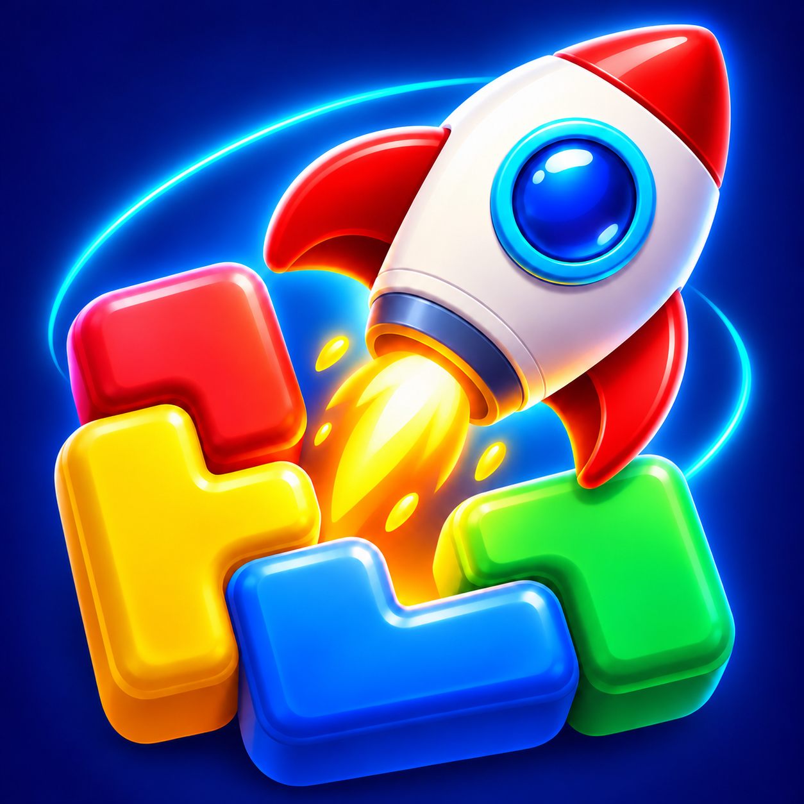

# Astro Flow Jam

**A space-themed casual puzzle game for iOS that combines a sliding block-jam puzzle with a pixel-art "rocket conveyor" that reveals a hidden picture.**

Unity 6 · C# · URP · iOS (iPhone + iPad) · Python level-generation pipeline · Blender

<!-- App Store: replace the line below with the live link when the app is published, e.g.
<a href="https://apps.apple.com/app/idXXXXXXXXXX"></a>
-->
**App Store:** coming soon (v1.0.0 is in review)

</div>

### Store screenshots

<p align="center">
  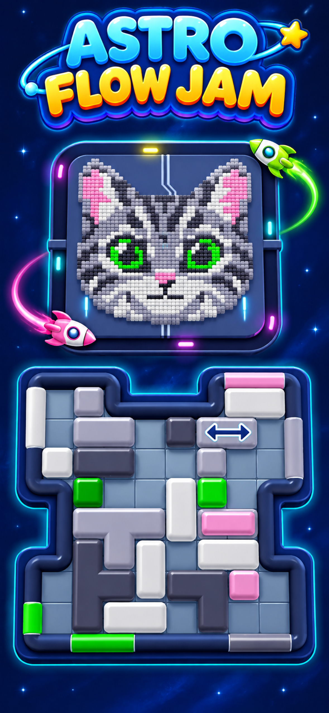
  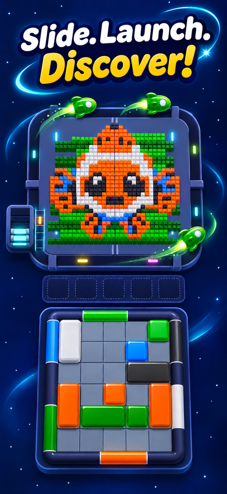
  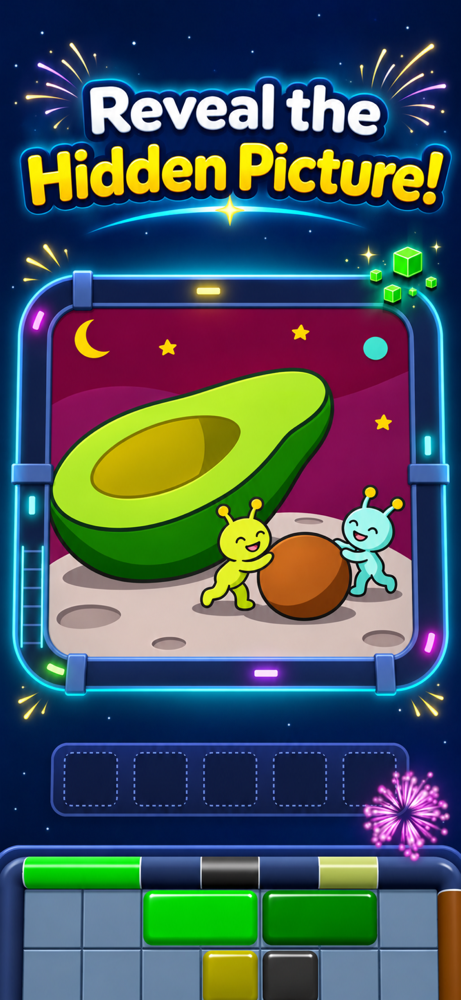
  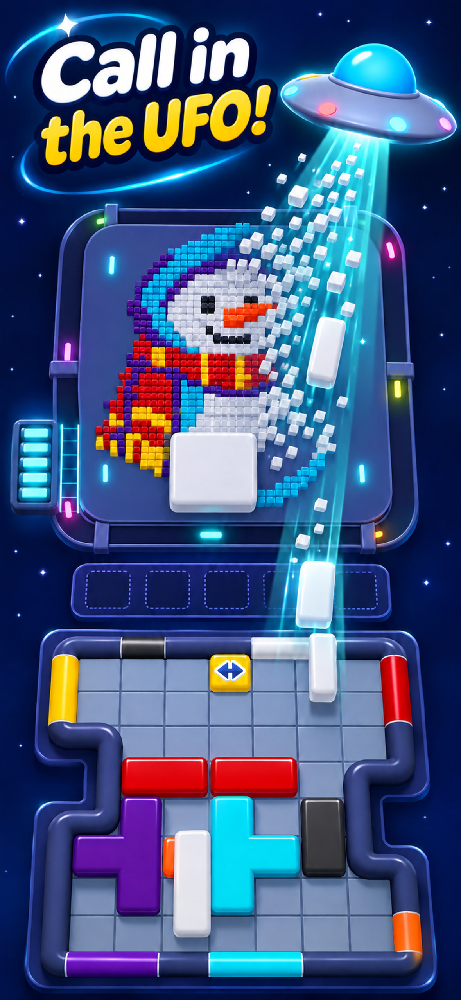
  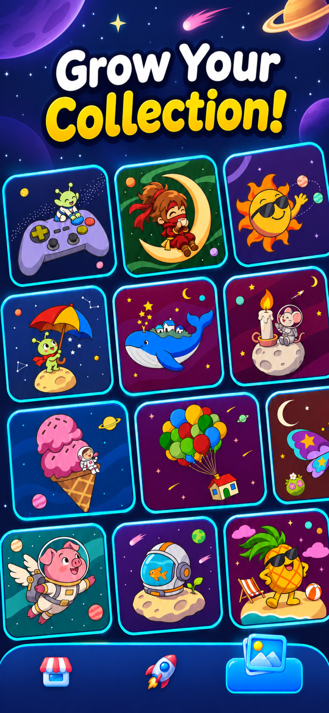
</p>

### In-game

<p align="center">
  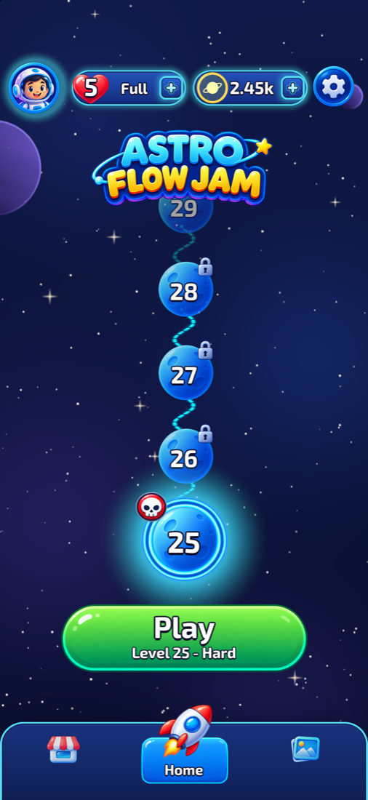
  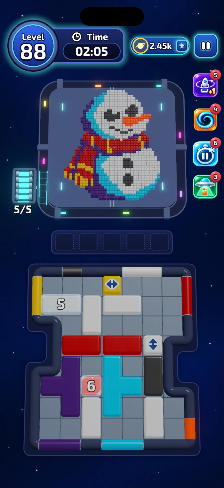
  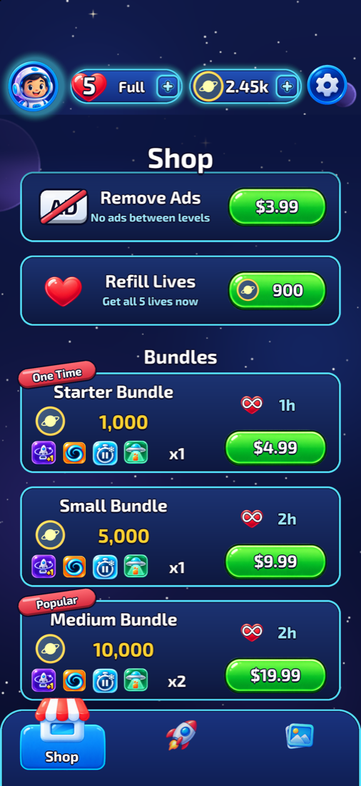
  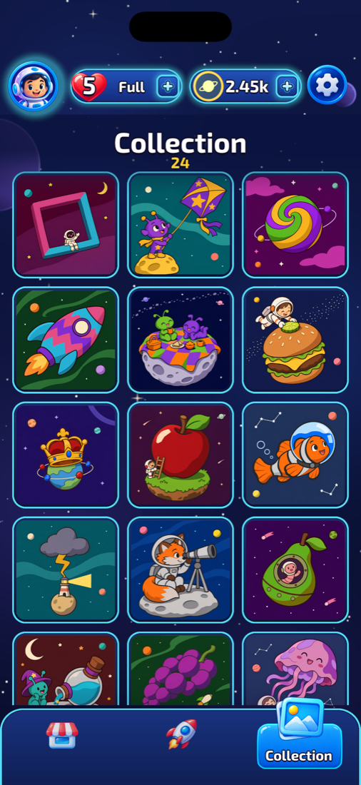
</p>
<p align="center"><sub>Home map · Level 88 (hangar board with frozen and one-way blocks; orbit; pixel picture; boosters) · Shop · Collection</sub></p>

---

## Table of contents

1. [The game in one minute](#the-game-in-one-minute)
2. [Core mechanics](#core-mechanics)
3. [Board mechanics](#board-mechanics)
4. [Boosters](#boosters)
5. [Progression, economy and monetization](#progression-economy-and-monetization)
6. [Technical architecture](#technical-architecture)
7. [Procedural level designer](#procedural-level-designer)
8. [Art pipeline](#art-pipeline)
9. [Testing](#testing)
10. [Analytics and live tuning](#analytics-and-live-tuning)
11. [Building and releasing](#building-and-releasing)
12. [Repository layout](#repository-layout)
13. [Status and credits](#status-and-credits)

---

## The game in one minute

Every level has two linked halves:

- **Bottom: the hangar board.** A sliding-block puzzle. Colored blocks are jammed on a grid with colored gates around the
  edge. The player drags a block to the gate of its own color and pushes it through.
- **Top: the orbit.** A pixel picture sits inside a square track. When a block leaves the board, each of its cells turns
  into a **rocket** that launches onto the orbit. While circling, each rocket shoots the outermost pixels **of its own
  color** that line up with it. Clearing the pixels peels the picture layer by layer.

When the last pixel is gone, the final rocket hits the padlock, the **reward door** slides open and a hidden illustration
is revealed and added to the player's **Collection**.

The tension comes from the coupling. The orbit has limited capacity and only a few parking slots. Sending a rocket whose
color is not exposed on the outside of the picture wastes space. The board decides *which* rockets you can launch, the
picture decides *which ones are useful right now*, and a timer keeps the pressure on.

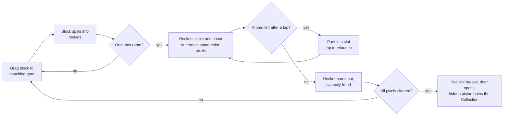

---

## Core mechanics

### Board (sliding puzzle)

| Rule | Implementation |
|---|---|
| Blocks are dragged with real physics: the selected body follows the finger with a velocity proportional to the remaining distance, so it slides along obstacles instead of snapping through them. | `BoardInput`, `RocketView` (one rounded-box collider per cell) |
| A block can leave through a gate only if (a) the colors match, (b) the gate is at least as wide as the block's footprint along that edge, and (c) the straight path from every cell to the edge is clear. | `BoardModel.CheckGate`, `BoardModel.CheckExit` |
| Exits are checked continuously while dragging. When a block reaches a fitting gate, the gate arms open; the block has to be pushed halfway through before it commits. | `BoardInput`, `GateView`, `LevelController.Exit` |
| Releasing a block snaps it to the nearest free cell. | `BoardInput` |
| A level is only valid if a full exit order exists. | `BoardSolver` (Core, also used by tests and the importer) |

### Orbit and shooting

| Rule | Implementation |
|---|---|
| Capacity is measured in units: a small rocket uses 1, a big rocket 2. Default capacity is **5**. Rockets that are mid-launch already count, and the reservation is atomic at exit time. | `OrbitModel` |
| Every rocket fires at about **20 shots per second**. Each shot targets the first filled pixel, seen from the rocket's edge of the track, on the rows or columns aligned with it (with a small tolerance). The pixel must match the rocket's color and must not already be reserved by another bullet. | `ShooterTargeting`, `ConveyorRunner.Shooting` |
| A rocket's ammo equals its share of that color's pixels. Each color's total ammo equals its pixel count exactly, so every level is perfectly balanced. | `CapacityPlanner` |
| After a full lap, a rocket that still has ammo hops into a free waiting slot (a big rocket takes two). If no slot is free, it laps again. Tapping a parked rocket sends it back to the orbit when there is room. | `ConveyorRunner.Slots` |
| Rockets keep a minimum spacing on the track, and a rocket at the back pushes the one in front. | `ConveyorRunner.Motion`, `BeltPath` |

### Win and lose

- **Win:** every pixel cleared → padlock explosion, door animation, coin reward (×2 with a rewarded ad).
- **Lose: out of time.** The timer starts on the first move and pauses while dialogs and tutorials are open.
- **Lose: out of space.** The orbit and slots are full and no rocket on the track can hit anything.
- **Continue offer:** the first continue is free (once per player). After that the price climbs **900 → 1900 → 2900 → 3900
  → 4900** coins within the level. A continue gives +30 seconds or +1 waiting slot, depending on how the level was lost.

---

## Board mechanics

New mechanics are introduced gradually. Each one appears first on an easy level with a short in-game explainer, then
comes back regularly.

| Mechanic | Rule |
|---|---|
| **One-way block** | Slides only along its axis (an arrow is drawn on it), so it can only exit through gates perpendicular to that axis. |
| **Holes** | Missing cells shape the board; they act as walls. |
| **Frozen block** | Cannot move until *N* other blocks have left the board (the counter is shown on the block). |
| **Key and lock** | A locked block opens only after the block carrying the matching key has fully exited. |
| **Asteroid** | A permanent rock occupying cells; it never moves. |
| **Counter asteroid** | Explodes after *N* exits (with a particle explosion), freeing its cells. |
| **Layered block** | Two colors. Passing through the outer color's gate launches the outer layer as rockets; the block stays on the board in its inner color. |

The rules live in pure C# (`BoardModel`, `BoardSolver`) and are mirrored one-to-one in the Python level designer's solver,
so every generated level is proven solvable before it ships.

---

## Boosters

| Booster | Effect |
|---|---|
| **Hangar** | +1 waiting slot and +1 orbit unit for the rest of the level (up to 3 times: capacity 5 → 8). |
| **Warp** | Pick any block. A wormhole swallows it and spits its rockets straight onto the orbit, with no path or gate needed. It also pulls frozen and locked blocks (this breaks the ice or the lock). |
| **Freeze** | Stops the timer for 10 seconds. |
| **UFO** | Pick a color. A UFO beams up everything of that color: board blocks, rockets on the orbit and in slots, and the matching pixels in the picture. |

Each booster unlocks at a set level with 2 free uses. After that it can be bought in packs of 3 with coins.

---

## Progression, economy and monetization

- **Levels:** 120 handcrafted-by-pipeline levels ship in v1.0. The order lives in a single `LevelDatabase` list, so
  moving a level means moving one entry.
- **Collection:** every cleared level unlocks its hidden illustration in a scrollable gallery. Pictures are loaded on
  demand and reference-counted to keep memory low (`LevelPictures`).
- **Lives:** at most 5, one refills every 30 minutes in real time (also while the app is closed), or all of them for 900
  coins. A life is lost when you give up a level, or when you leave or restart after the timer has started.
- **Coins:** 400 to start, 40 per cleared level (×2 with a rewarded ad).
- **In-app purchases (Unity IAP 5, App Store):**
  - 6 coin packs
  - 6 bundles with coins, boosters and hours of infinite lives (the starter bundle can be bought once)
  - **Remove Ads**, which removes interstitials only; rewarded ads stay available
  - Purchases are granted before they are confirmed, and transaction IDs are de-duplicated, so a crash mid-purchase never
    double-grants or loses an item.
- **Ads (AdMob):** interstitials only after a win, starting at level 20, at most one per 60 seconds. Rewarded ads are
  opt-in: an extra life, or double coins.
- **Privacy:**
  - Google UMP consent form for EEA, UK and Swiss players, plus a **Privacy Choices** button in Settings that only appears
    there.
  - Apple's App Tracking Transparency prompt is shown after level 3, not at first launch.
  - Firebase Analytics runs with ad-storage consent denied.

---

## Technical architecture

### Assemblies

```
AstroFlowJam.Core     (pure C#, no MonoBehaviours, fully unit-tested)
 ├─ Board/            BoardModel (gates, paths, mechanics), BoardSolver (exit-order search)
 ├─ Orbit/            OrbitModel (unit capacity), CapacityPlanner (ammo = pixels), BeltPath (track geometry)
 ├─ Pixels/           BeadGrid, ShooterTargeting (target selection rules)
 ├─ Levels/           LevelGenerator, LevelSimulator (frame-by-frame rules + "reasonable player" bot)
 └─ Shared/           colors, tuning constants

AstroFlowJam          (runtime, depends on Core)
 ├─ Level/            LevelController split into partial classes by concern:
 │                    Exit, Boosters, Warp, Ufo, Economy, Finale, Guide (tutorials), Home, Camera
 ├─ Board/            BoardInput (physics drag), BoardView, GateView, RocketView (+Morph, Mechanics, Feedback)
 ├─ Orbit/            ConveyorRunner (+Motion, Shooting, Slots, Cartridges), ConveyorTrack, CartridgeDepot
 ├─ Pixels/           BeadField (pixel layer and reveal), RewardDoor
 ├─ Boosters/ FX/     UFO stage and liquid-pull effects, particles
 ├─ UI/               HUD, Home (map, shop, collection, settings), popups; the UI is built entirely in code
 └─ Services/         GameSave, Lives, CoinWallet, BoosterInventory, Store (IAP), Ads, Tracking (ATT),
                      Telemetry (Firebase), Haptics, Sfx, DevTools

AstroFlowJam.Editor   level importer, build pipeline (BuildIOS), iOS plist post-processing, project setup
```

### Design decisions worth calling out

- **Rules in Core, presentation in Runtime.** Everything that decides an outcome (can this block exit, which pixel
  does this rocket shoot, is the orbit full, is this level solvable) is plain C#, with no Unity types beyond
  math. The same rules run in the game, in the editor validator, in the unit tests and, ported, in the Python
  simulator.
- **One `LevelController` split into partial classes.** Each gameplay concern (boosters, economy, tutorials, finale)
  lives in its own file without a web of cross-references between managers.
- **Code-built UI.** The HUD, home screen, shop, collection and all popups are built procedurally (`UiBuild`, `UiArt`).
  Sprites such as capsules, gradients, the infinity mark and badges are generated at runtime, and only illustrated art is
  imported as textures. Layout adapts to every iPhone and iPad aspect ratio from one code path.
- **Single save gateway.** All persistence goes through `GameSave`, which caches PlayerPrefs reads (they cross into
  native code on iOS and some are polled every frame). All keys live in `SaveKeys`, and a changed key string would wipe
  progress, so they are frozen.
- **Build-flavor flags instead of `Debug.isDebugBuild`.** `Debug.isDebugBuild` turned out to return true in an iOS
  release build, which exposed the developer menu. Developer tools are now driven by explicit scripting defines
  (`AFJ_DEV`, `AFJ_SHOTS`, `AFJ_STORE`) that the build script sets per flavor.
- **Fail-soft services.** Ads, IAP and Firebase never block gameplay. If an ad is not loaded the flow continues, if the
  store is offline the release build says so, and if Firebase is not configured telemetry is a no-op.

---

## Procedural level designer

`unity/Tools/leveldesigner` is a Python pipeline (about 4,000 lines) that creates levels **picture first, board second**,
then plays each candidate with simulated players to measure difficulty. Its output is the `LevelData` assets in
`unity/Assets/_Project/Data/Levels`.

```
spec ─► pixel picture + hidden illustration ─► board ─► simulation ─► level.json ─► Unity importer
 │        │ patterns: rule-based              │ rocket inventory    │ expert + human-like bots
 │        │ icons/silhouettes: image model    │ block splitting     │ win rate, time, "fun" score
 │        │ grid detection + cleanup          │ annealing + gen-and-test
 └─ difficulty wave, mechanic calendar, palette, uniqueness
```

### 1. Level spec (`spec.py`, `targets.py`)
- **Difficulty wave:** a 10-level cycle (Easy, Easy, Medium, Easy, Hard, Easy, Medium, Easy, Hard, Very Hard) with
  intensity rising over the game.
- **Mechanic calendar:**
  - Each board mechanic has an introduction level, a burst of appearances right after it, a long-term frequency, and a
    maximum gap after which it is forced back in.
  - The number of simultaneous mechanics grows with progress: 1, then 2, 3 and 4.
  - An introduction level is always Easy and shows only the new mechanic.
- **Picture targets per level range:**
  - Levels 1–5 are simple patterns with 2–3 colors.
  - Later levels are full-square icons with 3–7 colors on 20–28 cell grids.
  - Silhouettes and larger grids come in later still.
  - Harder levels get slightly busier pictures; the real difficulty lives on the board.
- **No repeated subject** in the first 100 levels, and not within any 60-level window after that.

### 2. Picture (`patterns.py`, `codex_art.py`, `picture.py`)
- Early levels use **rule-based patterns**: rings, stripes, checkers, spirals, diamonds, bricks.
- Later levels prompt an **image model** with a subject-specific brief. The pipeline then:
  - detects the model's own pixel grid in the image
  - re-samples it onto the target grid
  - removes speckle noise
  - opens the outer black outline, so pixels can be shot from the edge
  - validates the picture against the spec (region sizes, color balance, small details, symmetry), and re-prompts with
    feedback on failure
- Each level also gets a **hidden reward illustration**: a space-themed cartoon scene tied to the level's subject, with
  varied settings so neighboring levels never look alike.

### 3. Board (`board_gen.py`, `board_solver.py`)
- **Rocket inventory:** pixels per color are split into rockets (ammo = pixels). The rockets are grouped into blocks and
  placed with simulated annealing.
- **Gates** are placed so that blocks of the outer picture layer sit near their gates, while inner-layer blocks wait
  behind them. Freeing the front of the queue opens both the picture and the path.
- Mechanics are placed following positional rules, for example:
  - a lock never sits in a corner
  - asteroids never touch the edge or split the board
  - frozen counters are 25–60% of the block count
- **Solver:** the drag model mirrors the game exactly, including layered blocks, ice counters, keys and asteroid
  counters. A board the expert bot cannot clear is rejected.

### 4. Simulation (`sim.py`): difficulty is measured, not guessed
- Every candidate is played many times by a **noisy bot**. Several candidates are generated at different difficulty
  settings, and the settings drift until at least two candidates fall inside the target win-rate band. The best four
  are re-measured with 40 runs each.
- The finalists are then played by **three human-like player profiles**: novice 30%, average 50%, good 20%. These bots
  have:
  - log-normal thinking time
  - an initial look at the board
  - a tendency to miss rare colors and forget parked rockets
  - occasional second-best or impulsive moves
  - slow drags
- **Time limit** = 80th percentile of the average player's untimed completion time × a margin per difficulty tier
  (1.3–1.45) + 10 s, rounded to 5 s and clamped to 60–300 s. Early levels get generous fixed limits.
- **Selection:**
  1. in the target band for the noisy bot
  2. in the target band for the human profiles, with a cap on novices losing to the clock
  3. highest board score, plus a **fun** score: many useful options at decision points and little idle time, where
     "useful options" are counted by the expert bot
- If no board fits, the level's heaviest mechanic (never the newly introduced one) is dropped and generation retries.

### 5. Import
`DesignerLevelImporter` (Unity editor menu) turns each `level.json` into a `LevelData` asset and imports the hidden
picture. The level is validated again with the C# `BoardSolver` on import.

> The pipeline's targets were calibrated from market research on level structure and difficulty curves in the genre.
> That research data (`data/`, `analysis/`) and the generated output (`out/`) are not included in this repository. The
> pipeline still runs without them and falls back to its built-in color and difficulty tables.

---

## Art pipeline

- **3D (Blender → FBX → Unity URP):**
  - modular board pieces: floor, rounded walls, corner pieces
  - two-arm sliding gates
  - seamless 1×1 blocks with connector pieces, so a block of any shape looks like one piece
  - a rocket that folds into a block cell and unfolds when it leaves (`RocketView.Morph`)
  - the orbit track with a cartridge depot and launch ramp, the reward door with padlock, the UFO, asteroids

  Sources are in `art/3d`. Large n-gons are triangulated before export, because Unity drops them.
- **2D:** UI concept art (`art/ui`) is rebuilt in code where possible. Illustrated elements (planets, avatars, booster
  icons, the logo, the loading screen) are imported as sprites.
- **Juice:** squash-and-stretch launches, pixel pops, gate arm easing, padlock explosion, liquid-pull UFO and wormhole
  effects. Haptics on block pick-up, gate exit and every shot (rate-limited), pitch-varied SFX with an anti-spam limit.

---

## Testing

- **58 automated tests** (Unity Test Framework):
  - Edit Mode covers board rules and mechanics, target selection, the pixel grid, level validation and generation,
    picture loading, the coin wallet and the save layer.
  - Play Mode runs a smoke test of the prototype scene.
- Tests run headless in batch mode before every device build.
- **Shipped-level validation:** every imported level must pass `BoardSolver`, and `LevelValidationTests` re-checks the
  whole level database.

---

## Analytics and live tuning

`Telemetry` wraps Firebase Analytics and Crashlytics. Events are designed for **difficulty tuning from real player data**:

| Event | Key parameters |
|---|---|
| `level_start` | level, content hash (`version`), attempt number |
| `level_end` | result (`win` / `give_up_time` / `give_up_space` / `quit` / `restart`), seconds, pixels left, progress %, continues, boosters |
| `level_fail` | fail kind, seconds, pixels left, progress % |
| `continue_used`, `booster_used`, `booster_bought`, `spend_virtual_currency`, `out_of_lives` | economy funnel |
| `ad_rewarded`, `ad_interstitial`, `ad_impression` (with revenue), `iap_purchase` | monetization |

The level `version` is a short FNV-1a hash of the level asset. When a level is regenerated, its old and new data stay
separable in the dashboard. Personal data is never sent.

---

## Building and releasing

**Requirements:** Unity 6000.3, Xcode, CocoaPods, macOS.

1. Download the **Firebase Unity SDK 14.1.0** packages (`com.google.firebase.app`, `.analytics`, `.crashlytics` `.tgz`)
   into `unity/GooglePackages/`. They are referenced from `Packages/manifest.json` and are too large to keep in git.
2. Add your own `GoogleService-Info.plist` to `unity/Assets/`. Without it the game runs and telemetry is disabled.
3. Open `unity/` in Unity and use the **Astro Flow Jam → iOS Derle** menu, or run from the command line:

```bash
Unity -batchmode -quit -projectPath unity -executeMethod AstroFlowJam.Editor.BuildIOS.AppStore
```

| Build method | Purpose | Defines |
|---|---|---|
| `Simulator` / `Device` | development builds with the DEV menu (coins, boosters, timer, level jump) | `AFJ_DEV` |
| `SimulatorRelease` | store screenshots: release UI, tap the level badge to win | `AFJ_SHOTS` |
| `DeviceRelease` | release build with Google test ad units, for on-device QA | none |
| `AppStore` | the submission build with real AdMob units | `AFJ_STORE` |

A post-process step (`IosPlistPatch`) adds the ATT usage text and the export-compliance flag, and weak-links
`AppTrackingTransparency`. The generated Xcode workspace is archived and uploaded with `xcodebuild -exportArchive`.

---

## Repository layout

```
astroflowjam/
├─ unity/                    Unity project
│  ├─ Assets/_Project/       game code (Scripts/Core, Runtime, Editor), art, data, tests
│  └─ Tools/leveldesigner/   Python level generation pipeline (afj/)
├─ art/
│  ├─ 3d/                    Blender sources and FBX exports
│  ├─ ui/                    UI concept art
│  └─ pixel/                 early pixel-art studies
├─ audio/                    sound effects
├─ store/                    App Store screenshots, icon, listing copy
└─ docs/                     game design documents (GDD v0.1, v0.2), in-game screenshots
```

---

## Status and credits

- **Status:** v1.0.0 submitted to the App Store (iPhone and iPad).
- **Design, development, 3D models and art direction:** Mustafa Sepen.
- Pixel pictures and hidden illustrations for later levels are produced by the image-model pipeline described above,
  then validated and quantized automatically.

© Mustafa Sepen. All rights reserved. The source is published for portfolio viewing. The game, its art and its levels may
not be redistributed or published.
